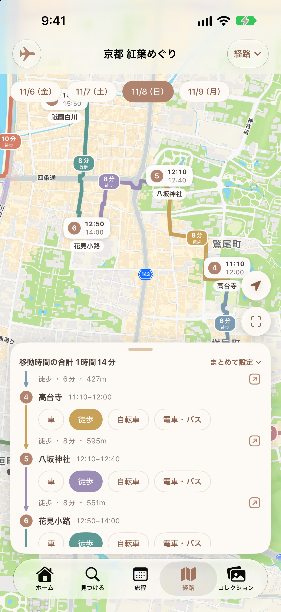
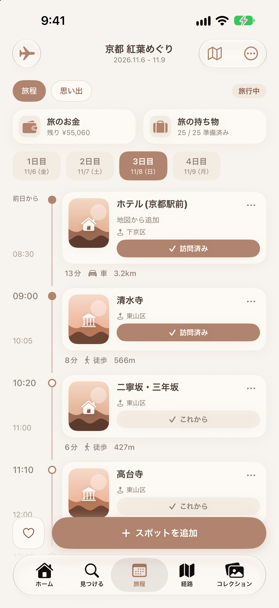
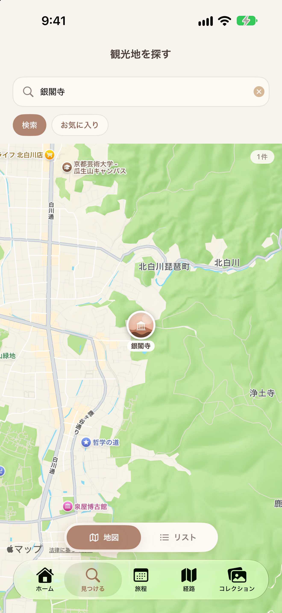
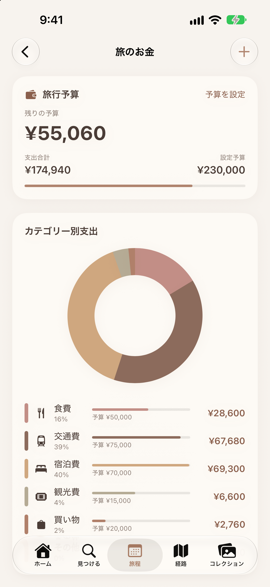
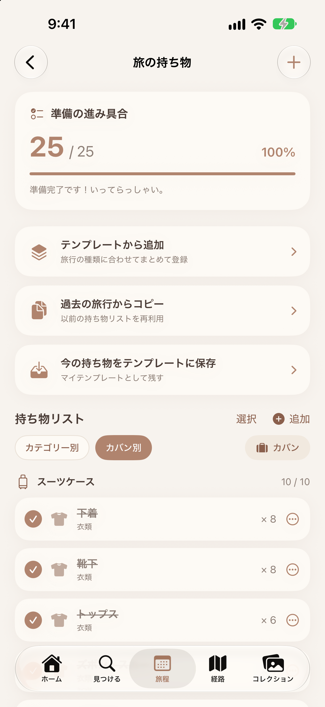
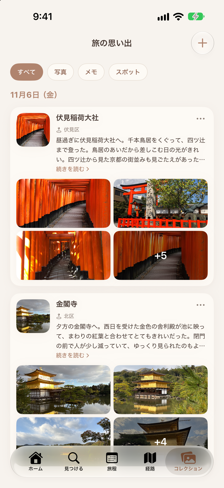
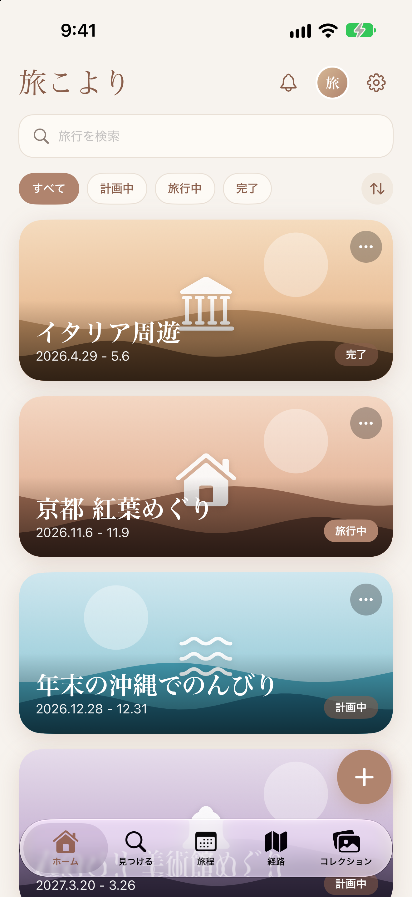
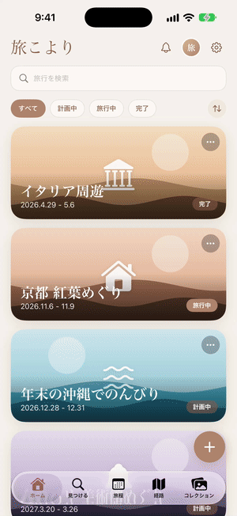
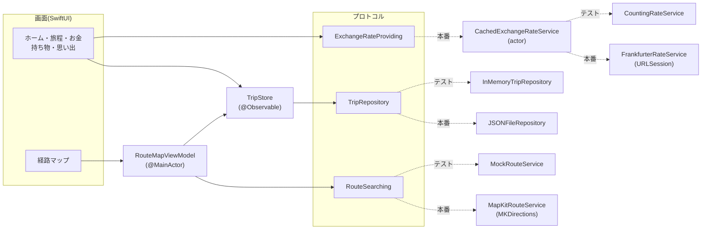

<!-- Tests のバッジは .github/workflows/tests.yml を追加すると表示される -->

# 旅こより(Tabikoyori)

<!-- ](https://github.com/itoshota-dev/tabikoyori/actions/workflows/tests.yml) -->


<a href="https://apps.apple.com/jp/app/id6830959908?itscg=30200&itsct=apps_box_badge&mttnsubad=6830959908" style="display: inline-block;">

</a>

<br>

<p align="center">
  
  
  
  
</p>

<br>

<!-- [English](README.en.md) -->


## 目次

1. [アプリ概要](#1-アプリ概要)
2. [スクリーンショット・デモ](#2-スクリーンショットデモ)
3. [開発背景・解決したい課題](#3-開発背景解決したい課題)
4. [主な機能](#4-主な機能)
5. [使用技術・開発環境](#5-使用技術開発環境)
6. [アーキテクチャ](#6-アーキテクチャ)
7. [開発で工夫したこと・直面した課題](#7-開発で工夫したこと直面した課題)
8. [テスト・品質保証](#8-テスト品質保証)
9. [開発プロセス・AIの活用](#9-開発プロセスaiの活用)
10. [課題・今後の改善](#10-課題今後の改善)
11. [ビルド・実行方法](#11-ビルド実行方法)
12. [その他の情報](#12-その他の情報)


---

## 1. アプリ概要

「旅こより」は、**旅の計画・移動・お金・持ち物・思い出を、ひとつにまとめる iPhone アプリです。**

旅程のタイムライン、区間ごとの移動手段と所要時間がわかる経路マップ、予算と支出(外貨の自動換算つき)、持ち物リスト、写真とメモの思い出を、1 つのアプリで管理できます。
アカウント登録は不要で、データは端末の中だけに保存します。

> **名前の由来**：「こより」は、和紙を細くよって作った糸のことです。ばらばらになりがちな旅の情報を、1 本の丈夫な糸によりあわせるように、ひとつにまとめたいという思いを込めました。アイコンの紙飛行機も、同じく和紙をモチーフにしています。


---

## 2. スクリーンショット・デモ

<p align="center">
  
  
  
  
</p>

<p align="center">
  
  
  
  
</p>

| 画面 | 内容 |
|---|---|
| 経路マップ | 区間ごとの移動手段・所要時間・道に沿った経路 |
| 旅程 | 日ごとのタイムライン。日付をまたぐ予定は「翌 8:00」のように表示 |
| スポット検索 | 地図や名前でスポットを探し、営業時間などの詳細を確認して旅程に追加。お気に入りに保存 |
| 旅のお金 | 予算設定と支出管理。支出のグラフ。外貨は支出日のレートで円に換算 |
| 持ち物リスト | カテゴリー別・カバン別の整理、テンプレートからの追加 |
| 思い出 | 写真とメモのタイムライン |
| ホーム | 旅行の一覧(計画中・旅行中・完了で絞り込み、検索、並べ替え) |


---

## 3. 開発背景・解決したい課題


### 背景

旅行の準備をアプリでしようとすると、旅程はメモアプリ、行き先や経路は地図アプリ、持ち物はリマインダーアプリ、支出は家計簿アプリ……と、情報があちこちに散らばります。
もちろん、表計算アプリだけでもある程度はカバーできます。
しかし、そのたびに旅程・持ち物・支出など、それぞれの形式に合わせて表を一から作り、整えるのは手間がかかります。
そこで、**スマートフォンで見やすい「旅のしおり」のようなアプリ**を目指して、表を作らなくても旅程・移動・お金・持ち物・思い出までをすべてまとめて記録・管理できる、**旅の前・旅の最中・旅の後をひとつにまとめられるアプリ**を開発しました。


### 解決したい課題

| 課題 | このアプリでの解決 |
|---|---|
| 旅の情報がいくつものアプリに分かれる | 旅程・地図・お金・持ち物・思い出を 1 つのアプリにまとめる |
| 移動にかかる時間がわからず、予定が詰め込みすぎになる | 区間ごとの所要時間を自動で調べ、予定の重なりも知らせる |
| ホテルの宿泊や夜間のイベントなど、日付をまたぐ予定が書きにくい | 「翌 2:00」のように、日付をまたぐ予定をそのまま扱う |
| 海外旅行で、いくら使ったかが円でわからない | 現地の通貨で入力すると、支出日のレートで円に換算する |
| 毎回、持ち物リストを一から作るのが面倒 | テンプレートや過去の旅行から、まとめて追加する |
| 旅行の記録を、他のサービスに預けたくない | アカウント不要で、データは端末の中だけに保存する |


---

## 4. 主な機能

### 旅程
- 日ごとのタイムラインで、予定の開始・終了時刻を管理
- ホテルの宿泊や夜間のイベントなど、**日付をまたぐ予定**を「翌 8:00」のように表示し、翌日の旅程にも表示
- 時間が重なる予定のお知らせ、訪問済みのチェック
- 画面の端のスワイプで、前の日・次の日へ移動

### 経路マップ
- 旅程の順に、番号と時刻を地図上の各予定に表示
- 区間ごとに、車・徒歩・自転車・電車/バスから移動手段を選択
- 所要時間・距離・道に沿った経路を表示(電車・バスは所要時間の目安)
- 乗り換えは、ワンタップで Apple マップで確認

### スポット検索・お気に入り
- Apple マップのデータから行きたい場所を検索し、旅程に追加
- 地図とリストの切り替え、お気に入りへの保存
- スポットの詳細(営業時間・電話番号・WebサイトURL・住所)を Apple マップの詳細カードで表示

### 旅のお金
- 旅行全体とカテゴリーごとの予算の設定
- 支出の記録、カテゴリー別の支出のグラフ
- **外貨での支出**:通貨を選んで現地の金額を入力すると、**支出日の為替レートを自動で取得**して円に換算(手入力も可能)

### 持ち物リスト
- カテゴリー別・カバン別の整理
- 持ち物を選択や一括選択して操作可能（チェック・チェック解除・希望のカバンへ移動・削除など）
- 「国内旅行」「海外旅行」「アウトドア」などの初期テンプレート、自分でテンプレートを作成可能
- 過去の旅行の持ち物リストをコピー

### 思い出
- 写真とメモを、日付ごとのタイムラインで記録
- 旅行ごと、またはすべての旅行の思い出をまとめて振り返り

### そのほか
- アカウント登録は不要。データは端末の中だけに保存
- アイコンのボタンは、すべて VoiceOver で読み上げに対応


---

## 5. 使用技術・開発環境

| 分野 | 使用技術 |
|---|---|
| 言語 | Swift 6(Strict Concurrency) |
| UI | SwiftUI |
| 状態管理 | Observation(`@Observable`) |
| 非同期処理 | Swift Concurrency(async/await、`actor`、`Task` の取り消し) |
| 保存 | Codable + JSON ファイル(アトミックな書き込み) |
| 地図・経路 | MapKit(`MKLocalSearch` / `MKDirections` / `MKMapItemDetailViewController`) |
| 通信 | URLSession(為替レート:[Frankfurter](https://frankfurter.dev)、API キー不要) |
| 写真 | PhotosUI(`PhotosPicker`) |
| テスト | Swift Testing(ユニットテスト)、XCTest(UI テスト) |
| バージョン管理 | Git / GitHub |
| 外部ライブラリ | なし(Apple 純正のフレームワークのみ) |
<!--| CI | GitHub Actions |-->

| 開発環境 | バージョン |
|---|---|
| Xcode | 27.0 |
| 対応 OS | iOS 26.0 以降 |
| 対応端末 | iPhone(縦向き) |


---

## 6. アーキテクチャ

各画面（SwiftUI の View）は、アプリ全体のデータを持つ TripStore（@Observable）からデータを読み取って表示します。TripStore のデータが変わると、そのデータを使っている画面だけが自動で更新されます。
処理が複雑な経路マップだけは、`RouteMapViewModel` に処理を分けています。
保存・経路検索・為替レートの取得はプロトコルで抽象化し、外から実装を渡せるようにしています（依存性の注入）。本番では実際の保存・通信を行う実装を、テストではメモリ上で動く実装や決まった結果を返す実装を使います。



| 役割 | 主な型 |
|---|---|
| データ(モデル) | `Trip`、`ItineraryItem`、`Expense`、`PackingItem`、`Memory`、`Currency` |
| アプリのデータの管理 | `TripStore`(データの変更と保存。保存に失敗したら変更前に戻す) |
| 保存 | `TripRepository`(`JSONFileRepository` / `InMemoryTripRepository`) |
| 外部とのやりとり | `RouteSearching`、`ExchangeRateProviding`、`PlaceSearch` |
| 画面の処理 | `RouteMapViewModel`(経路マップ) |

### フォルダ構成

```
Tabikoyori/
├── App/        アプリの入り口、タブ、画面の移動
├── Models/     旅行・予定・支出・持ち物・通貨などのデータ
├── Stores/     TripStore(アプリのデータ)と、保存の仕組み
├── Services/   経路検索・スポット検索・為替レート・位置情報・写真
├── Utilities/  表示の書式、地図の表示範囲の計算
└── Views/      画面(機能ごとのフォルダ)
TabikoyoriTests/    ユニットテスト(Swift Testing)
TabikoyoriUITests/  UI テスト(XCTest)
docs/               名前の記録、App Store の掲載文、プライバシーポリシーの原文
```


---

## 7. 開発で工夫したこと・直面した課題

### 7.1 UI・UX で工夫したこと

#### 1. 旅程と移動が一目でわかる経路マップ
旅程表だけでは、予定どうしの位置関係や移動にかかる時間がわかりにくく、地図アプリと行き来する必要がありました。
そこで、地図に予定の場所を**訪問順の番号付きのピン**で並べ、それぞれに訪問時刻を表示しました。地図上の予定の間には、移動手段ごとに検索した**経路と所要時間**を表示しています。
画面下にも旅程を表示し、地図と同時に見れるようにしました。そして、この画面下の旅程カード内の区間と地図上の経路は**色をそろえ**、どの区間がどの経路と対応するかを目で追えるようにしました。
さらに、地図上の訪問時刻や移動手段・所要時間の札を**タップするとその場で吹き出しが開き**、画面を切り替えずに訪問時刻や移動手段を変えることができます。

#### 2. 予算と支出をまとめて管理できる「旅のお金」
旅行中の支出は、いくら使ったか、予算に対してどのくらいかが把握しにくいものです。
本アプリでは、旅行全体の予算に加えて、**カテゴリーごとに予算を設定**でき、残りの金額がすぐわかるようにしました。支出のカテゴリー内訳は**ドーナツグラフ**で表示し、何にお金を使っているかを一目で確認できます。
また、海外旅行では、外貨で入力すると**支出した日の為替レートで自動的に円に換算**するようにもしています。最後に使った通貨を覚えておくので、旅行中は通貨を選び直す必要がありません。

#### 3. すぐに準備を始められる持ち物リスト
持ち物リストを毎回一から作るのは手間がかかり、入れ忘れの原因にもなります。
そこで、**テンプレートからボタン1つで**よく使う持ち物をまとめて追加でき、自分で作ったリストもテンプレートとして保存できるようにしました。また、過去の旅行の持ち物をコピーすることもできます。
さらに、持ち物は**カバンごとにまとめられる**ので、「スーツケース」「機内持ち込み」のように、どこに入れたかまで管理できるようにもしています。

### 7.2 技術的に工夫したこと

#### 1. 保存に失敗しても、データが壊れない
変更はすべて `TripStore.commit` を通します。変更前の状態を控えてから変更し、**保存に失敗したら変更前に戻す**仕組みです。
「思い出」の写真やメモなどのデータを消すときは、データの上書き保存に**成功してから**写真ファイルを消すので、保存に失敗しても写真だけが消えることはありません。
起動時に保存済みのデータが壊れていて読み込めなかった場合は、元のファイルを別名で残してから空の状態で始めます。別名で残せなかったときは保存を止め、元のデータが上書きされないようにしています。

#### 2. 経路検索の「古い結果」を使わない
区間ごとの経路検索は時間がかかるため、検索の途中で移動手段を変えることがあります。
問い合わせごとに ID を付けて、**遅れて届いた古い結果は旅程に保存しない**ようにしました。
一度調べた区間はキャッシュし、出発地・到着地が変わったときだけ調べ直します。

#### 3. お金を正確に、通信を少なく
外貨の換算は `Double` ではなく **`Decimal`** で計算し、四捨五入して円にしています。`Double` では小数の誤差で、たとえば 6.25 ドル × 138.64 円/ドル = 866.5 円が 866.4999… になり、四捨五入すると 1 円少なくなってしまうためです。
過去の為替レートは変わらないので、**端末に保存して使い回します**。今日のレートは 1 日の途中で更新されることがあるため、保存してから 6 時間以上たっていれば、次に必要になったときに取り直します。この保存の仕組みは `actor` で実装し、同時に呼ばれても競合しないようにしています。
外部に送る情報は**通貨の種類と日付だけ**です。

### 7.3 開発で苦労したことと解決方法

#### 1. 電車・バスの経路の線が引けない
**問題**：移動手段に「電車・バス」を選んだ場合、地図に経路の線を引けませんでした。移動手段をまだ選んでいない区間も、線がなく、どこからどこへ移動するのかがわかりませんでした。<br>
**原因**：MapKit の経路検索（`MKDirections`）は、電車・バスでは**所要時間の目安（ETA）しか返さず**、道筋の座標がもらえないためでした。<br>
**解決**：電車・バスと未選択の区間は、2 つの予定ピンを**「中が白い直線」**で結ぶことにしました。色付きの直線と白い直線を重ねて描くことで、道に沿った車や徒歩の経路（中まで塗った線）と見分けがつき、実際にその道を通るようには見えません。未選択の区間には「未選択」の札を出し、タップするとその場で移動手段を選べます。<br>
**学び**：API でできないことがあるときは、無理に再現するより、**できないことが利用者に正しく伝わる見せ方**を考えるのが大切だと学びました。

#### 2. 地図上のスポットに、営業時間などの詳細を出す
**問題**：スポットの営業時間・電話番号・ウェブサイトなどを表示したかったのですが、保存したスポットには名前と座標しかなく、詳細を出せませんでした。<br>
**原因**：詳しい場所の情報は Apple マップ側にあり、アプリで保存したスポットと Apple マップ上の場所を**結びつける手がかり**が必要でした。また、詳細カード（`MKMapItemDetailViewController`）は UIKit の部品で、SwiftUI からそのままでは使えませんでした。<br>
**解決**：スポットを保存するときに **Apple マップの場所の ID** も保存し、次に開くときはその ID で場所を取り直すようにしました。ID がない場合は近くを検索して探し、それでも見つからなければ名前と座標だけで表示します。詳細カードは `UIViewControllerRepresentable` で包んで SwiftUI から使えるようにしました。<br>
**学び**：外部のデータを使うときは、**見つからなかった場合の段階的な代わり**まで用意しておくと、どんな状況でも画面が壊れないと学びました。

#### 3. 経路の下のカードを、なめらかに動かす
**問題**：経路マップの下から引き出す旅程カードを指で動かすと、地図がカクついたり、カードを引き出す前後でカードの中身を切り替えたときにちらついたりしました。引き出したり戻したりしてカードの高さを変えると、表示している地図の位置がずれることもありました。<br>
**原因**：ドラッグ中の再描画に地図まで巻き込まれていたこと、中身の切り替えで画面を作り直していたこと、地図の余白を変えると MapKit が地図を描き直すことが原因でした。<br>
**解決**：カードを自作し（`DraggableSheet`）、**ドラッグ中の再描画をカードの中だけ**に閉じ込めました。中身の切り替えは作り直さず透明度だけで切り替え、指を離したときは**指の勢いを引き継ぐばねのアニメーション**で次の高さへなめらかに動かしています。また、地図の余白はカードの高さに関係なく固定にして、地図が動かないようにしました。<br>
**学び**：なめらかな動きのためには、**どの変更がどこまで再描画を起こすか**を意識して、画面の部品を分ける必要があると学びました。


---

## 8. テスト・品質保証

### テストの内容

| 種類 | 確かめていること |
|---|---|
| 計算・変換 | お金の計算、旅行の状態(計画中・旅行中・完了)、日付をまたぐ予定、金額・所要時間・距離の表示の書式 |
| データの操作 | 予算・支出・持ち物・お気に入りの操作、**保存に失敗したときに元に戻る**こと |
| 非同期・外部とのやりとり | 経路検索のキャッシュ・取り消し・古い結果の破棄、為替レートの取得・エラーの分類・キャッシュ |
| 保存データ | 壊れたデータの扱い、**古い形式のデータ**(通貨の項目がない支出など)を読み込めること |
| UI テスト | 旅行を作成すると、ホームに表示されること(行き先が空のあいだは作成できないことも確認) |

- ユニットテスト 88 個(Swift Testing)と、UI テスト 1 個(XCTest)
- 保存先はメモリの中、経路検索と為替レートはテスト用の偽物(モック)に差し替え、**端末のデータや通信に頼らず**に、何度実行しても同じ結果になるようにしています
- 同じテストを複数の入力で繰り返す**パラメータ化テスト**で、境目の値(予算を超えたとき、1 分未満、日帰りなど)を確かめています
- UI テストは、起動時に `-ui-testing` を渡すと、空のデータで始まります(本番のビルドには含まれません)

### 品質を保つための取り組み

<!--- GitHub に push するたびに、**GitHub Actions** でビルドとテストを自動実行-->
- Swift 6 の言語モードでビルドし、並行処理の問題をコンパイル時に検出
- テスト用の偽物（Mock）が設定どおりに動くかを確かめるだけのテストは、アプリの動作を何も確かめていないため削除するなど、テストの数より中身を重視して見直しています。
- **アクセシビリティ**：アイコンだけのボタンにも VoiceOver の読み上げ名を付け、UI テストでもその名前でボタンを探しています。


---

## 9. 開発プロセス・AIの活用

### 開発の進め方

1. まず動くものを作り、実際に使いながら画面と機能を調整
2. 公開に向けた準備（プライバシーマニフェスト、プライバシーポリシー、名前の決定と商標の確認など）。名前の検討と、商標・既存サービスとの重複の確認は [docs/NAMING.md](docs/NAMING.md)
3. 2026年11月11日に App Store で公開。公開後に見つけた不具合は、原因を調べて修正版として配信
4. 変更は 1 つの目的ごとにコミット(`feat:`、`fix:`、`refactor:`、`test:` などの種類を付けて、英語で記述)


### AI の活用

このアプリは、AI アシスタント(Anthropic の Claude)と対話しながら開発しました。役割は次のとおりです。

| 担当 | 内容 |
|---|---|
| **自分** | アプリの企画と、作りたい機能・仕様の決定 / 画面のデザインと使い勝手の判断 / 実機・シミュレーターでの動作確認と、不具合や違和感の発見 / AI の提案の取捨選択 / コードをプロジェクトに反映し、ビルド・テストを実行 / コミットの単位と内容の判断 |
| **AI** | 実装のコードの提案 / テストの提案 / エラーの原因の調査 |

AI の提案をそのまま使うのではなく、**変更のたびに内容の説明を受けて理解してから反映**し、動作とテストで確かめています。
AI が提案したコードがビルドできなかったときは、エラーの内容を確かめて原因を調べ、修正しました（例：定義されていない関数の呼び出し、プロパティの初期化忘れ、SwiftUI の部品や他の型との名前の衝突、引数の順番の誤り）。


### 名前の決め方

アプリ名は、候補を比較したうえで、商標(J-PlatPat)と既存のサービスとの重複を確認して決めました。記録は [docs/NAMING.md](docs/NAMING.md) にあります。


---

## 10. 課題・今後の改善

| 課題 | 改善の方針 |
|---|---|
| データは端末の中だけで、**機種変更のときに引き継げない** | iCloud(CloudKit)による同期、またはファイルへの書き出し・読み込み |
| 通貨は、よく使う 18 種類からしか選べない | すべての通貨から検索して選べる一覧 |
| 日本語のみ | String Catalog を使った英語対応 |
| ダークモードに対応していない(明るい表示に固定) | 色の定義を見直し、暗い表示にも対応 |
| 支出の画面の為替レートの取得処理が、View の中にある | ViewModel に分け、取得の流れもテストできるようにする |
| UI テストは、主要な操作 1 つだけ | 予定の追加、持ち物のチェックなど、主要な操作を順に追加 |
| 電車・バスは、経路の線を表示できず所要時間の目安のみ | Apple マップで開く導線を改善 |
| 旅行を、ほかの人と共有・共同編集できない | iCloud の共有機能の利用を検討 |
| 旅行の日付を端末のタイムゾーンで扱っているため、**日本で作った旅行を海外で開くと、日付が 1 日ずれる**ことがある | 日付を時刻を含まない形で保存し、どの国から見ても同じ日付になるようにする。あわせて、夏時間の切り替え日の扱いも実機で確認する |
| 読み込めなかった保存データは別名で残しているが、**そこから復元する方法がない** | データをサポートに送れるようにする、または壊れていない部分だけを読み込む |


---

## 11. ビルド・実行方法

### 動作環境

| 項目 | 内容 |
|---|---|
| 開発環境 | Xcode 27.0 / macOS 26.6.1 |
| 対応 OS | iOS 26.0 以降 |
| 動作確認 | iPhone 16(iOS 27.0.1)の実機、iPhone 18 Pro(iOS 27.0)・iPhone 16(iOS 26.0)のシミュレーター |

### 手順

```bash
git clone https://github.com/itoshota-dev/tabikoyori.git
cd tabikoyori
open Tabikoyori.xcodeproj
```

| 操作 | 方法 |
|---|---|
| 実行 | Xcode で実行先に iPhone のシミュレーターを選び、⌘R |
| テスト | ⌘U(ユニットテストと UI テスト) |
| 準備 | 外部ライブラリを使っていないので、追加のセットアップは不要 |

- 開発チームの設定がない場合、実機での実行には「Signing & Capabilities」で自分の Team を選んでください(シミュレーターでは不要)
- 地図の表示、経路検索、スポット検索、為替レートの取得には、インターネットへの接続が必要です（旅程・持ち物などの表示と編集は、オフラインでも使えます）


---

## 12. その他の情報

| 項目 | 内容 |
|---|---|
| 動作環境 | iOS 26.0 以降の iPhone |
| 公開状況 | App Store で公開中(2026年11月11日〜)：[旅こより - 旅のしおり・旅行計画](https://apps.apple.com/jp/app/id6830959908) |
| プライバシー | 開発者はデータを集めません。[プライバシーポリシー](https://itoshota-dev.github.io/tabikoyori/privacy.html) |
| 関連文書 | [名前の決め方](docs/NAMING.md) / [App Store の掲載内容](docs/APP_STORE.md) / [プライバシーポリシー(原稿)](docs/PRIVACY_POLICY.md) |
| 作者 | Shota Ito([@itoshota-dev](https://github.com/itoshota-dev)) |
| 連絡先 | itoshota.dev@gmail.com |

### ライセンス

このリポジトリのコードは、ポートフォリオとして**閲覧していただくために公開**しています。
オープンソースのライセンスは付けていないため、著作権は作者に帰属し、作者の許可なく複製・改変・再配布・利用することはできません。

© 2026 Shota Ito. All rights reserved.
